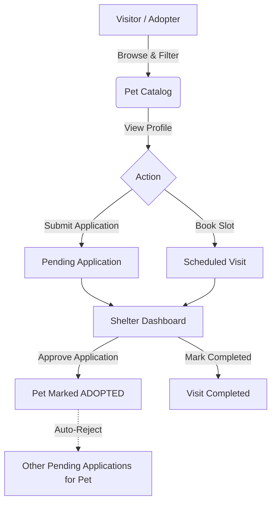

# 🐾 PawConnect — Animal Shelter & Pet Adoption Portal

[](https://www.php.net/)
[](https://www.mysql.com/)
[](css/style.css)
[](https://www.apachefriends.org/)
[](LICENSE)

**PawConnect** is a comprehensive, production-ready Pet Adoption Web Portal built with procedural PHP (`mysqli` with prepared statements), MySQL, HTML5, and plain CSS3 (no external CSS/JS frameworks or Composer dependencies required). 

It connects verified animal rescue organizations and shelters with potential adopters, featuring full adoption lifecycle workflows, real-time multi-criteria filtering, slot-based visit scheduling with double-booking prevention, and role-based access control.

---

## 🌟 Key Features & Capabilities

### 1. 🐶 For Prospective Adopters
- **Multi-Parameter Pet Search:** Filter pets simultaneously by **Species** (Dogs, Cats, Rabbits, Birds, Other), **Gender**, **Size** (Small, Medium, Large), **Age Category** (Puppy/Kitten, Young, Adult, Senior), **City**, and **Adoption Status**.
- **Pet Profiles:** High-resolution photos, vaccination badges, detailed personality/story descriptions, and shelter direct contact information.
- **Online Adoption Application:** Submit home details, experience, and adoption motivation with duplicate application prevention.
- **Visit Scheduling:** Interactive date/time picker (10:00 AM - 05:00 PM) with Sunday blackout rules and automatic slot-conflict prevention.
- **Personal Tracker:** Real-time dashboards for *My Applications* and *My Visits* (with one-click visit cancellation).

### 2. 🏢 For Animal Shelters & Rescue Organizations
- **Shelter Dashboard:** Live metrics tracking Total Rescues, Available Pets, Pending Applications, and Upcoming Visits.
- **Pet Inventory Management:** Add, edit, and delete pets with image validation (JPG/PNG/WEBP $\le$ 2MB, automatic `uniqid()` renaming) or web image URLs.
- **Adoption Decision Workflow:** Review applicant details with an automated approval cascade (approving an application sets pet status to **Adopted** and marks other competing applications for that pet as **Rejected**).
- **Visit Log:** Monitor scheduled visitors and mark outcomes as **Completed** or **Cancelled**.

### 3. 🛡️ For Portal Administrators
- **Master Directory:** Unified view of all registered user accounts, verified shelters with pet tallies, and global pet listings.
- **Account Management:** System oversight and user account removal with foreign key cascade protection.

---

## 🏛️ System Architecture & Workflow



---

## 📁 Repository File Structure

```text
PawConnect/
├── config/
│   └── db.php                     # MySQLi connection & dynamic base URL configuration
├── includes/
│   ├── auth.php                   # RBAC, CSRF token verification, flash messages & helpers
│   ├── header.php                 # Responsive navigation bar with mobile toggle & alert container
│   └── footer.php                 # Footer with navigation links & scripts
├── css/
│   └── style.css                  # Pure CSS stylesheet (Poppins font, warm theme, responsive grid)
├── uploads/
│   └── default.png                # Fallback SVG/PNG pet avatar placeholder
├── shelter/
│   ├── dashboard.php              # Shelter metrics, inventory overview & applications preview
│   ├── add_pet.php                # Pet profile creation with image file validation
│   ├── edit_pet.php               # Pet details, availability status & image updater
│   ├── delete_pet.php             # Pet deletion handler with image unlinking
│   ├── view_applications.php      # Application review and approval cascade workflow
│   └── manage_visits.php          # Shelter visit scheduler & completion tracking
├── admin/
│   └── dashboard.php              # System overview of all users, shelters, and pets
├── index.php                      # Homepage (Hero search, dynamic counters, featured pets)
├── register.php                   # Dual registration for Adopters & Shelter organizations
├── login.php                      # Secure login with session regeneration
├── logout.php                     # Clean session destruction
├── pets.php                       # Multi-filter search & pagination grid (9 pets/page)
├── pet_details.php                # Detailed pet specs, shelter contact card & action buttons
├── apply.php                      # Adoption application submission with duplicate checks
├── schedule_visit.php             # Visit booking (Sunday blackout & slot collision detection)
├── my_applications.php            # Adopter application tracker with status badges
├── my_visits.php                  # Adopter visit schedule tracker with cancel feature
├── seed.php                       # 1-Click Database installer & demo dataset seeder
├── database.sql                   # Complete SQL schema DDL & 36-pet realistic dataset
├── .gitignore                     # Git ignore rules for logs, environment, and cache
└── README.md                      # Project documentation
```

---

## 🚀 Quick Setup Guide (Local Machine / XAMPP)

### Step 1: Clone or Download Repository
Clone this repository directly into your local server web directory:
```bash
cd C:/xampp/htdocs
git clone https://github.com/Amal-kphilip/PawConnect.git
```
*(Or download the ZIP and extract into `C:\xampp\htdocs\PawConnect`)*

### Step 2: Start Apache & MySQL
Open your **XAMPP Control Panel** and click **Start** for both **Apache** and **MySQL**.

### Step 3: Initialize Database (1-Click Automated Setup)
Open your web browser and navigate to:
```text
http://localhost/PawConnect/seed.php
```
*This automatically creates the `pet_adoption` database, configures all tables, and populates 36 realistic pets, 6 animal shelters across Kerala, 10 adopters, 14 applications, and 14 visits with secure bcrypt-hashed passwords.*

### Step 4: Open Application
Visit:
```text
http://localhost/PawConnect/
```

---

## 🔑 Demo Login Accounts

> **Default password for all demo accounts:** `password123`

| Role | Organization / User | Email Address | Password |
| :--- | :--- | :--- | :--- |
| **Admin** | Master Administrator | `admin@pawconnect.com` | `password123` |
| **Shelter 1** | Happy Tails Shelter (Kochi) | `shelter1@happytails.org` | `password123` |
| **Shelter 2** | Safe Paws Rescue (Kannur) | `shelter2@safepaws.org` | `password123` |
| **Shelter 3** | Second Chance Animal Home (Kozhikode) | `shelter3@secondchance.org` | `password123` |
| **Shelter 4** | Karuna Animal Sanctuary (Thiruvananthapuram) | `shelter4@karuna.org` | `password123` |
| **Shelter 5** | Paws & Care Foundation (Thrissur) | `shelter5@pawscare.org` | `password123` |
| **Shelter 6** | Green Valley Animal Rescue (Kottayam) | `shelter6@greenvalley.org` | `password123` |
| **Adopter 1** | Anjali Nair | `anjali@gmail.com` | `password123` |
| **Adopter 2** | Rahul Menon | `rahul@gmail.com` | `password123` |
| **Adopter 3** | Fathima Rasheed | `fathima@gmail.com` | `password123` |

---

## 🔒 Security & Code Standards

- **SQL Injection Prevention:** 100% parameter binding using MySQLi prepared statements across all queries.
- **Cross-Site Request Forgery (CSRF):** Unique cryptographic tokens validated on state-changing forms (`apply.php`, `schedule_visit.php`, `add_pet.php`, etc.).
- **Password Security:** PHP `password_hash()` (Bcrypt) storage with `session_regenerate_id()` upon authentication to prevent session fixation.
- **Cross-Site Scripting (XSS):** Context-safe sanitization via `htmlspecialchars(..., ENT_QUOTES, 'UTF-8')`.
- **Role-Based Access Control:** Isolated privilege enforcement preventing unauthorized access between adopter, shelter, and admin endpoints.

---

## 📄 License
This project is open-source under the [MIT License](LICENSE). Developed as an academic full-stack project.
